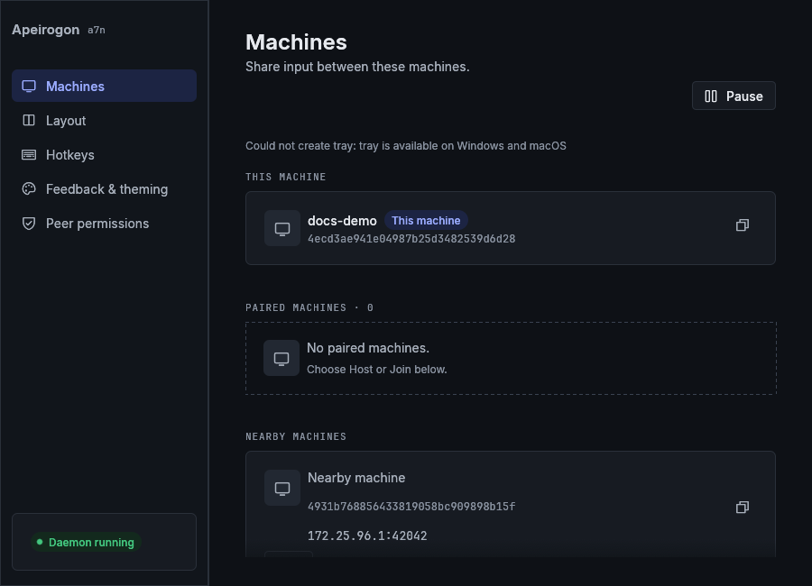
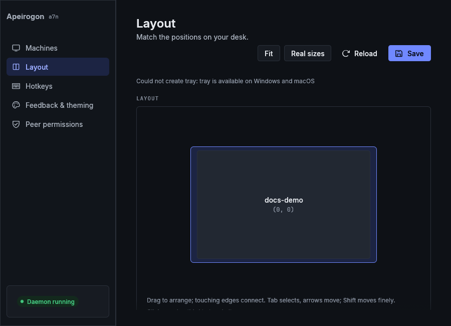
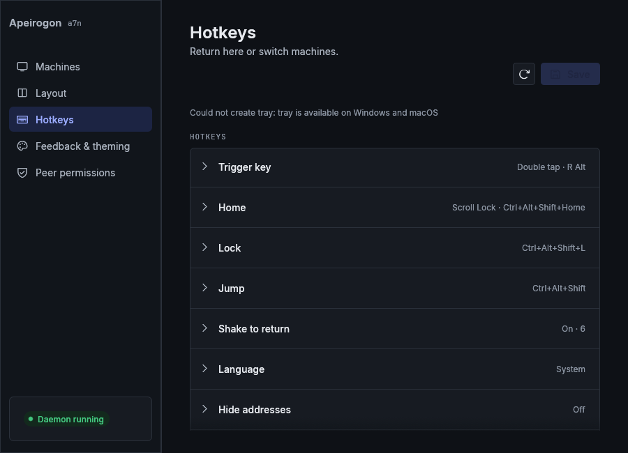
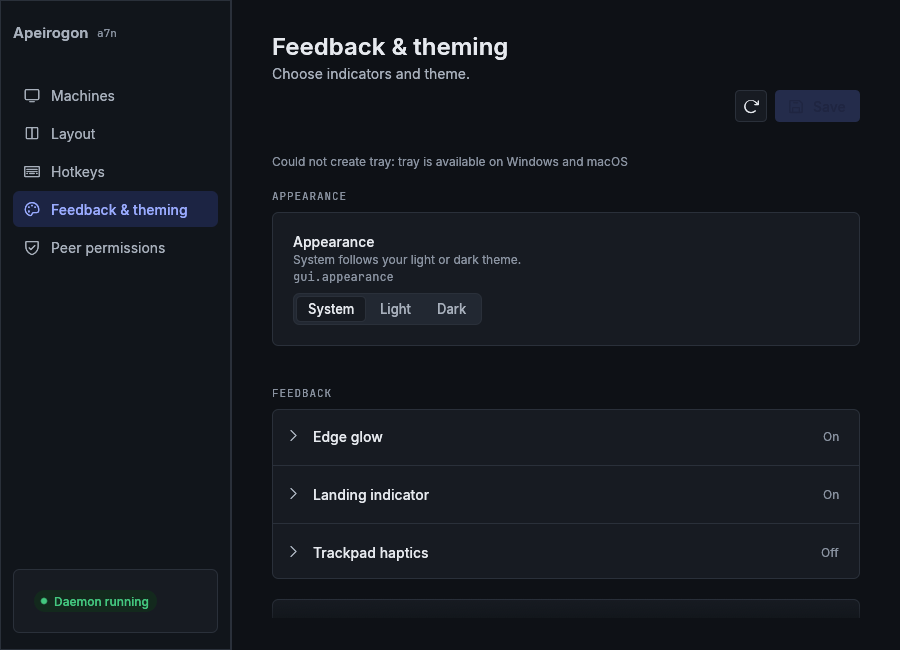
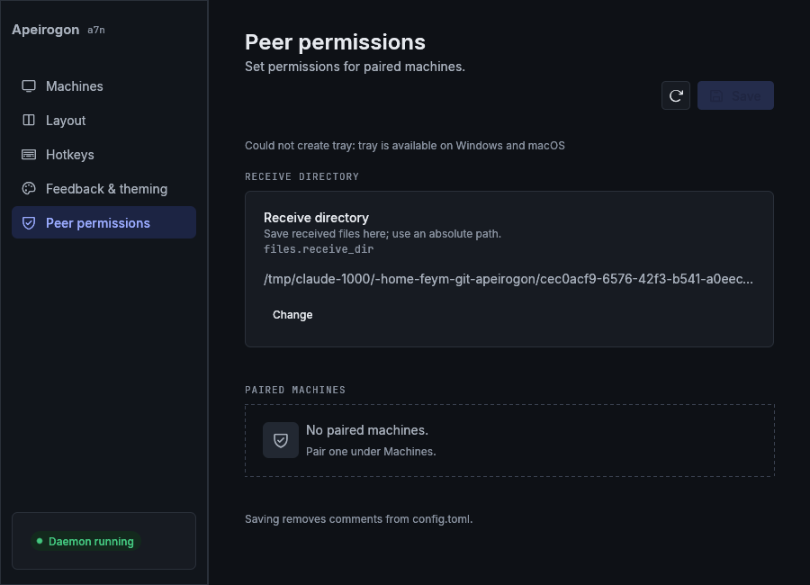
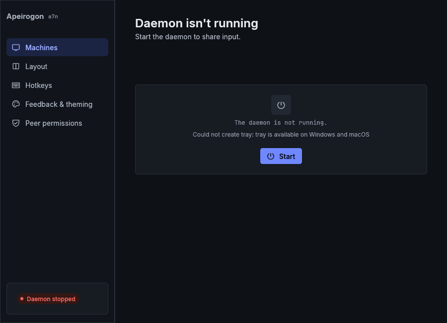

# User guide

Apeirogon runs a daemon in each user's desktop session. The CLI (`a7n`)
and GUI (`a7n-gui`) control that daemon. Install it on every machine using
[the README](../README.md#install).

## Getting started and pairing

Start the daemon on both machines:

```sh
a7n daemon start
```

Approve the OS permission requests described under
[troubleshooting](#troubleshooting). Keep both machines on the same local
network for initial setup.

On the first machine, run:

```sh
a7n pair
```

On the second, run the following with the first machine's IP address:

```sh
a7n pair 192.168.1.10
```

Enter the displayed one-time code at the prompt. If the first machine uses a
custom port, append it to the address. Pairing also accepts a nearby machine
id or unique hex prefix of at least four digits; `a7n status` lists nearby
machines and addresses.

For GUI pairing, open `a7n-gui` on each machine. On **Machines**, click
**Host** on the first machine. On the second, fill in **Address** and
**Pairing code**, then click **Join**. The code's remaining lifetime is
shown on the host. Generate a new code if it expires.



Screenshots show the Linux GUI; the tray is available on Windows and macOS only.

Use `a7n status` or **Machines** to check that the peer is connected.
Pairing remembers the peer's certificate pin for later connections.

## Layout

The layout describes your desk as a canvas of machine rectangles. Each
rectangle covers that machine's whole virtual desktop; the GUI draws its
monitors inside it.

Open **Layout** in the GUI, then drag the rectangles to match your physical
desk. Edges connect where rectangles touch. Vertical offsets and partial
edge overlaps work. **Real sizes** uses known physical screen sizes and
lines the machines up again; review the draft before clicking **Save**.
**Fit** fits the canvas to the view, and **Reload** fetches the saved layout.
Click an edge third on a rectangle to toggle whether leaving through that
third is blocked, then save.



For the terminal editor:

```sh
a7n layout
```

- Tab / Shift+Tab selects the next / previous machine.
- Arrow keys move it; Shift+arrow makes a smaller adjustment.
- `e` / Shift+`e` selects an edge third; `x` toggles whether it is blocked.
- Enter or `s` saves; Esc or `q` exits without saving.

The saved layout is shared across the desk. If another machine changes it
while you edit, reload before trying again.

## Switching machines

### Edges and hotkeys

Push the pointer outward against a connected edge until it crosses. Edge
resistance prevents accidental switches. Holding a mouse button blocks edge
crossing; release it before pushing again.

Default shortcuts on the machine whose keyboard and mouse you are using:

| Action | Shortcut |
| --- | --- |
| Return home | Double-tap Right Alt (Right Option on macOS) |
| Return home | Scroll Lock or Ctrl+Alt+Shift+Home |
| Toggle cursor lock on the current machine | Ctrl+Alt+Shift+L |
| Jump to a numbered machine in the layout | Ctrl+Alt+Shift+1 through 9 |

Alt is Option on macOS. Shaking the mouse left and right while driving a peer
also returns home. Change these bindings in **Hotkeys** or through the
`hotkeys` settings. The trigger can use double-tap, hold or both.



To switch explicitly, use a peer name, full machine id or unique hex prefix
of at least four digits:

```sh
a7n switch <machine>
```

`a7n pause` returns focus home and pauses outgoing input sharing.
`a7n resume` enables it again. Pause does not stop an allowed peer from
driving this machine, and it resets when the daemon restarts.

### Trackpad gestures

Three- and four-finger Mac trackpad swipes can trigger Windows shortcuts
while driving a Windows peer. Configure them on the receiving Windows
machine, in **Hotkeys** → **Trackpad gestures** or in config:

| Setting | Default shortcut | Windows action |
| --- | --- | --- |
| `gestures.swipe_up` | `meta+tab` | Task View |
| `gestures.swipe_down` | `meta+d` | Show desktop |
| `gestures.swipe_left` | `ctrl+meta+left` | Previous virtual desktop |
| `gestures.swipe_right` | `ctrl+meta+right` | Next virtual desktop |

Here `meta` is the Windows key. An empty binding disables that swipe.
Pinch and spread have no shortcut mapping. These settings stay local.
Gesture delivery and interaction with macOS system gestures still need
verification on real hardware.

### Wake-on-LAN

Switching to an offline paired machine by edge, jump shortcut or
`a7n switch <machine>` can wake it. The cursor waits for the peer to connect
before switching. `peers.<id>.wake` defaults to `true`; setting it to `false`
disables automatic wake for that peer.

To wake without moving focus:

```sh
a7n wake <machine>
```

The GUI also shows **Wake** for eligible offline peers. Connect once while
the peer is awake so Apeirogon can learn its hardware address. Enable
Wake-on-LAN in the target's firmware and OS. The machines must share a
network that carries broadcast packets; support depends on hardware and
network configuration.

## Clipboard

Copy on one paired machine and paste on another. Plain text, HTML and images
are supported. Small copies may transfer immediately; larger copies are
fetched when needed. Use `a7n clip` to check availability, copy metadata
and peer policies without displaying the copied content.

Set each peer's clipboard direction in **Peer permissions** or with:

```sh
a7n config set peers.<id>.clipboard ask
```

Replace `<id>` with the full machine id from `a7n status`. Policies are local
to this machine, and both ends must allow a transfer:

| Policy | Behaviour here |
| --- | --- |
| `both` (default) | Send and receive |
| `send` | Send only |
| `receive` | Receive only |
| `ask` | Send; hold incoming copies for confirmation |
| `off` | Neither send nor receive |

On the receiving machine, use `a7n clip accept` to apply a held copy or
`a7n clip reject` to discard it.

Content carrying an OS sensitivity marker is always excluded, before it is
announced to peers. This includes the supported macOS concealed-content,
Windows monitor-exclusion and KDE password-manager markers. This protection
cannot be disabled; it depends on the source app marking its content.

For additional exclusions, edit the local TOML file's `[clipboard]` table
and set `deny_apps` to a list of source app identifiers. Matching ignores
case and requires the OS to identify the source app. Wayland does not
provide that identity here, so only sensitivity markers apply there.
`clipboard.deny_apps` is not supported by `a7n config set`; edit the file
and restart the daemon. Clipboard exclusions and per-peer policies stay local.

## Files

Copy files or folders in your file manager and paste them on another paired
machine. Files download on paste into `files.receive_dir`, which defaults to
your Downloads directory under `Apeirogon` (`~/Downloads/Apeirogon` as a fallback).

To send files directly:

```sh
a7n send <peer> <path>...
a7n files accept <peer>
a7n files reject <peer>
a7n files cancel <id>
```

`<peer>` is a peer name, machine id or unique hex prefix of at least four digits.
`a7n send` follows the transfer; add `--no-wait` to return after offering it.
Use `a7n status` or the GUI to see held offers, progress and transfer ids for
cancellation. Accept or reject an offer on the receiving machine.

Per-peer `peers.<id>.files` defaults to `ask`: incoming sends need confirmation,
while a local paste counts as consent. Policies are `both`, `send`, `receive`,
`ask` and `off`. Receiving requires enough free space for the remaining download
plus a 256 MiB margin. Files are verified before publishing; existing files
are preserved by choosing a new name on collisions.

## Settings and the GUI

Use `a7n config` to inspect and change settings:

```sh
a7n config path
a7n config show
a7n config get input.speed
a7n config set input.speed 1.2
```

`path` prints the actual config location. The usual paths are:

| OS | Config file |
| --- | --- |
| Linux | `~/.config/apeirogon/config.toml` (or `$XDG_CONFIG_HOME/apeirogon/config.toml`) |
| macOS | `~/Library/Application Support/apeirogon/config.toml` |
| Windows | `%APPDATA%\apeirogon\config\config.toml` |

A missing file uses defaults. `show` includes default settings. `set`
validates, saves and reloads a supported key; changes to `name` and `port`
require a daemon restart. Saving through the CLI or GUI removes TOML comments
and formatting. After manual file edits, stop and start the daemon to reload.

`input.speed` defaults to `1.0`. Per-peer `pointer_speed` and `scroll_speed`
also default to `1.0`, and `reverse_scroll` defaults to `false`. Set these
under `peers.<id>` to adjust how input from that peer feels on this machine.
`peers.<id>.allow_drive` allows that peer to drive here;
`peers.<id>.drive_peer` allows this machine to drive it. Both default to `true`.
These per-peer settings stay local.

Open `a7n-gui`. **Machines** handles
pairing, connections, pause and file transfers. **Layout** arranges the desk.
**Hotkeys** contains shortcuts and input options. **Feedback & theming**
controls indicators and appearance. **Peer permissions** controls each peer's
input, clipboard and file permissions. Click **Save** after editing settings;
**Reload** discards pending edits and reloads the config.





## Autostart

Enable the per-user daemon at login:

```sh
a7n daemon enable
```

On Windows this writes the user's login entry and starts the daemon now.
On macOS it installs and loads a LaunchAgent. On Linux it installs and starts
a systemd user service; if systemctl is unavailable, the CLI reports that it
could not enable it automatically.

Inspect login status or disable autostart with:

```sh
a7n daemon status
a7n daemon disable
```

To stop the running daemon, use `a7n daemon stop`. On Windows, disabling
autostart removes the login entry but does not stop an already running daemon.

## Troubleshooting

### Daemon is not running

If the CLI reports that the daemon is not running, run `a7n daemon start`
in the same user's desktop session. The GUI shows **Daemon isn't running**
and a **Start** button. Check `a7n daemon status` and `a7n logs` if it fails.
Make sure the daemon binary is installed beside the CLI or available on PATH.



### OS permissions and desktop support

- **macOS:** grant **Accessibility** and **Input Monitoring** to the daemon
  in System Settings → Privacy & Security. The GUI shows missing permissions.
  Releases are unsigned, so re-grant both permissions after every update.
  Restart the daemon after granting them.
- **Wayland:** approve both InputCapture and RemoteDesktop portal dialogs.
  Support depends on the compositor and installed portal backend. Portals
  without persistent permission support may ask at every daemon start.
  Check `a7n status` for input availability and `a7n clip` for clipboard
  availability. Live GNOME/KDE compatibility still needs desktop verification.
- **X11:** run inside the logged-in graphical session with access to its X
  server. Input uses XInput2 and XTest; a headless or inaccessible display
  cannot provide desktop input sharing.

### Firewall

Allow the daemon's UDP port on both machines: **42042** by default (config
key `port`). Automatic discovery also uses mDNS on UDP **5353**.

On Windows, the daemon checks firewall rules and reports missing allows or
blocking rules in `a7n status` and the GUI. Review the reported rule and
network profile. For a missing allow, the UI supplies a command you can run
with administrator rights. The daemon does not change firewall rules itself.

### Peer shows “unreachable”

Check that both daemons are running and the machines can reach one another.
Confirm they are on the same network; VPN routes, guest Wi-Fi and wireless
client isolation can prevent connections. Check the peer's firewall too.

If discovery is unavailable, dial an already paired peer directly:

```sh
a7n connect <ip>[:port]
```

Omit the port to use the default. For IPv6 with a port, use `[IP]:port`.
Direct dialing still requires the paired certificate pin. Inspect `a7n logs`
on both machines; use `a7n logs --follow` to watch new events.

### After building from source

Stop every old daemon before starting the newly built one. Use
`a7n daemon stop` for the current session, then check for leftover daemons
started manually or through autostart. An old process can keep the local
socket or network port and leave new clients talking to the wrong version.
Keep the CLI, GUI and daemon from the same build, and start the new daemon
only after the old instances have exited.
