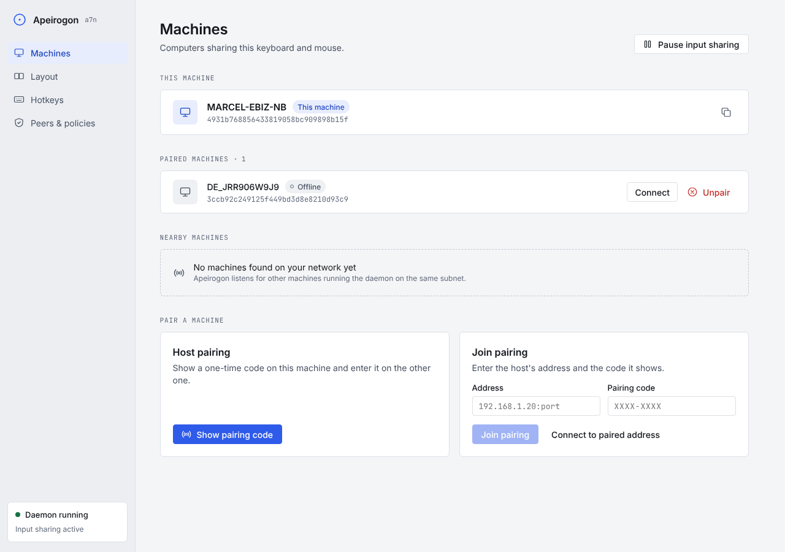
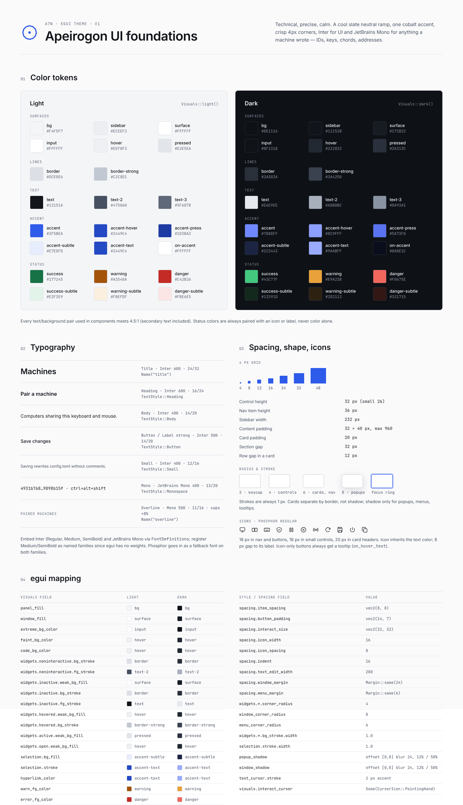
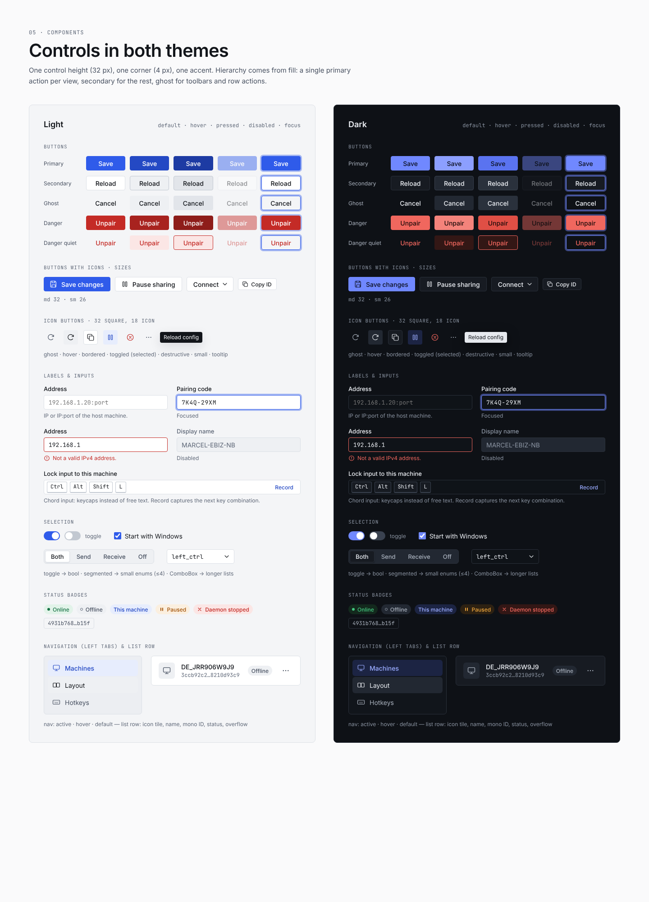
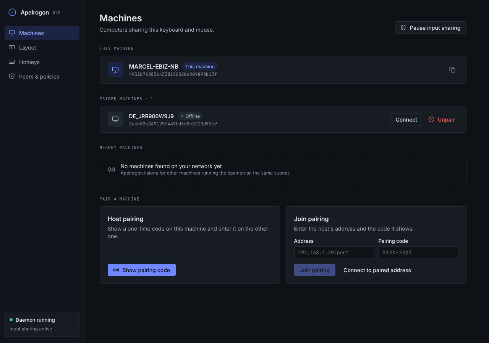
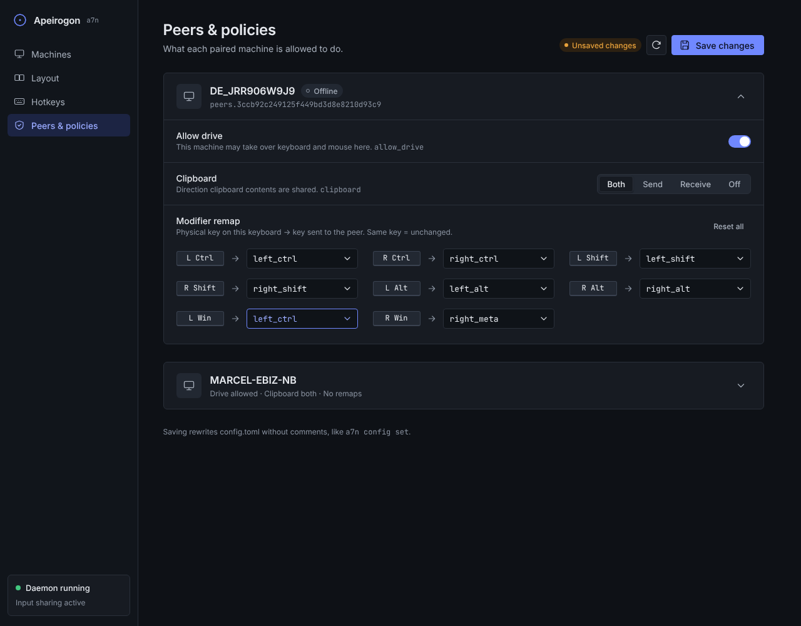
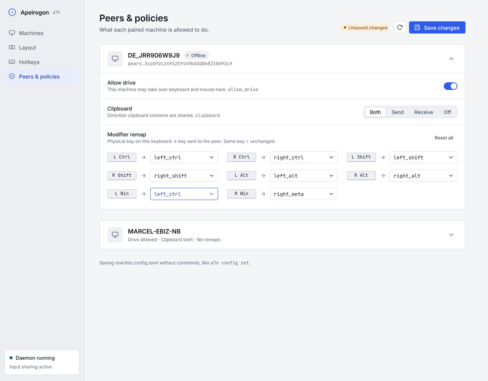

# Apeirogon UI guidelines

Design rules for the Apeirogon (`a7n`) settings app, built with egui. Use this file when you build or change any screen. All tokens and helpers live in [`theme.rs`](../crates/a7n-gui/src/theme.rs).

**Character:** technical and precise. Cool slate neutrals, one blue accent, 1 px lines, small radii (4 px controls, 6 px cards), Inter for the UI, JetBrains Mono for anything a machine wrote.



---

## 1. Setup

```toml
# Cargo.toml
egui = "0.36"          # or eframe = "0.36"
egui-phosphor = "0.14"
```

Put the static TTFs in `assets/fonts/`:

| File | Source |
|---|---|
| `Inter-Regular.ttf`, `Inter-Medium.ttf`, `Inter-SemiBold.ttf` | rsms.me/inter (static TTFs, **not** the variable font) |
| `JetBrainsMono-Regular.ttf` | jetbrains.com/lp/mono |

```rust
mod theme;

impl MyApp {
    fn new(cc: &eframe::CreationContext<'_>) -> Self {
        theme::install(&cc.egui_ctx); // fonts + light & dark style, follows the OS setting
        Self::default()
    }
}
```

Read colors in widgets with `let p = theme::Palette::of(ui.ctx());`. Never hard-code a hex value outside `theme.rs`.

---

## 2. Foundations



### Color tokens

| Token | Light | Dark | Use |
|---|---|---|---|
| `bg` | `#F4F5F7` | `#0E1116` | Window / central panel |
| `sidebar` | `#ECEEF2` | `#11151B` | Left navigation panel |
| `surface` | `#FFFFFF` | `#171B22` | Cards, secondary buttons, popups |
| `input` | `#FFFFFF` | `#0F1318` | Text fields, combo boxes |
| `hover` | `#EEF0F3` | `#222832` | Hover fill, neutral badge, icon tile |
| `pressed` | `#E2E5EA` | `#2A313C` | Pressed fill |
| `border` | `#DCE0E6` | `#2A303A` | Card / control borders, dividers |
| `border_strong` | `#C2C8D1` | `#3A4250` | Hovered borders, keycaps, toggle off |
| `text` | `#12151A` | `#E6E9EE` | Primary text |
| `text2` | `#475060` | `#A8B0BC` | Descriptions, idle nav items |
| `text3` | `#5F6878` | `#8A93A1` | Help text, IDs, overlines |
| `accent` | `#2F5BEA` | `#7088FF` | Primary button, toggle on, focus |
| `accent_subtle` / `accent_text` | `#E7EDFD` / `#2449C4` | `#1C2443` / `#9AABFF` | Selected nav item, toggled icon button |
| `success` | `#177245` | `#43C77F` | Online, daemon running |
| `warning` | `#A3540A` | `#E9A23B` | Paused, unsaved changes |
| `danger` | `#C42B26` | `#F0675E` | Unpair, errors, daemon stopped |

Every `*_subtle` color is the background for its matching foreground (badges, quiet buttons). All text and background pairs meet 4.5:1 contrast. Never show a status by color alone; always add a dot, icon or label.

### Typography

| Role | Font | Size / line | egui |
|---|---|---|---|
| Title (one per page) | Inter SemiBold | 24 / 32 | `theme::title_style()` |
| Heading (card title) | Inter SemiBold | 16 / 24 | `TextStyle::Heading` |
| Body | Inter Regular | 14 / 20 | `TextStyle::Body` |
| Button / strong label | Inter Medium | 14 / 20 | `TextStyle::Button`, `theme::font_medium(14.)` |
| Small (help text) | Inter Regular | 12 / 16 | `TextStyle::Small` |
| Mono (IDs, keys, addresses) | JetBrains Mono | 13 / 20 | `TextStyle::Monospace` |
| Overline (section label) | JetBrains Mono | 11, caps, +8 % tracking | `theme::overline(ui, "…")` |

Use mono for **machine IDs, IP:port, pairing codes, config keys (`allow_drive`), hotkey and modifier names**, and nothing else.

### Spacing and shape

- 4 px grid: 4 · 8 · 12 · 16 · 24 · 32 · 48.
- Control height **32 px** (small: 26). Nav item 36 px. Sidebar 232 px.
- Content padding 32 px (top) × 40 px (sides), max width **960 px**.
- Card padding 20 px, 12 px between rows in a card, **32 px between sections**.
- Radius: 3 keycap · 4 control · 6 card / nav item · 8 popup · 11 pill.
- Strokes are always 1 px. Cards are separated by borders, not shadows; only popups, menus and tooltips get a shadow.
- Focus: a 3 px ring in `focus` (accent at 40–45 %) around the control.

### Icons (Phosphor regular)

| Where | Size | Constant |
|---|---|---|
| Nav, buttons, icon buttons | 18 px | `size::ICON` |
| Small buttons, chevrons | 14–16 px | `size::ICON_SM` |
| Card icon tiles | 20 px | `size::ICON_LG` |

Icons inherit the text color, with 8 px between icon and label. **Every icon-only button needs a tooltip** (`icon_button` makes you pass one).

| Meaning | Icon |
|---|---|
| Machines | `MONITOR` |
| Layout | `SQUARE_SPLIT_HORIZONTAL` |
| Hotkeys | `KEYBOARD` |
| Peers & policies | `SHIELD_CHECK` |
| Pause / resume sharing | `PAUSE` / `PLAY` |
| Host pairing, nearby scan | `BROADCAST` |
| Unpair | `X_CIRCLE` |
| Reload config | `ARROW_CLOCKWISE` |
| Save | `FLOPPY_DISK` |
| Start daemon | `POWER` |
| Copy ID | `COPY` |
| Overflow menu | `DOTS_THREE` |
| Error | `WARNING_CIRCLE` |

---

## 3. Components



### Buttons: `theme::button(ui, kind, size, icon, label)`

| Kind | When |
|---|---|
| `Primary` | **One per view.** Save changes, Show pairing code, Start daemon, Join pairing. |
| `Secondary` | Other real actions: Pause input sharing, Connect, Fit to canvas. |
| `Ghost` | Toolbar and row actions, Cancel, Reset all, Connect to paired address. |
| `Danger` | Confirming something destructive inside a dialog. |
| `DangerQuiet` | Destructive actions in a list row (Unpair): red text, no fill until hovered. |

Labels use sentence case and a verb: "Save changes", not "Save settings" / "SAVE". Disabled controls drop to 45 % opacity; wrap them in `ui.add_enabled_ui(cond, …)`.

### Icon buttons: `theme::icon_button(ui, kind, icon, tooltip, selected)`

32 × 32, 18 px icon. `Ghost` for toolbars and rows, `Bordered` when it sits next to secondary buttons, `Danger` for destructive actions. `selected = true` shows a toggled state (accent-subtle fill).

### Inputs: `theme::text_input(ui, label, &mut value, hint, mono)`

Label above (13 px Medium), field 32 px tall, help or error text below in 12 px (`text3` or `danger`, with a `WARNING_CIRCLE` icon for errors). Set `mono = true` for addresses, codes and IDs.

**Hotkeys** display as keycaps with `theme::chord(ui, "ctrl+alt+shift+l")`. A Ghost "Edit" button swaps them for a mono `text_input` using the existing config syntax. Do not record chords: egui cannot distinguish left and right modifiers, which settings such as `right_alt` require.

### Choosing a selection control

| Value | Control |
|---|---|
| bool (`allow_drive`) | `theme::toggle(ui, &mut v)` inside a `setting_row` |
| small enum (`clipboard`, including Ask) | `theme::segmented(ui, &mut v, &[(Both,"Both"),(Send,"Send"),…])` |
| longer list (modifier remap target) | `egui::ComboBox` (styled by the theme) |

### Badges: `theme::badge(ui, kind, text)`

`Online` · `Offline` (hollow dot) · `Accent` ("This machine") · `Warning` ("Paused", "Unsaved changes") · `Danger` ("Daemon stopped").

### Layout pieces

- `theme::card(ui, |ui| …)`: a bordered surface with 20 px padding.
- `theme::overline(ui, "Paired machines")`: the label above each section. Add a count where useful ("Paired machines · 1").
- `theme::page_header(ui, title, subtitle, |ui| actions)`: a title, a one-line description, and actions aligned right.
- `theme::setting_row(ui, title, help, Some("allow_drive"), |ui| control)`: one setting, with the config key shown small in mono.

---

## 4. App shell (left tabs)

egui has no vertical tab widget. Use a fixed `SidePanel` with `nav_item` rows.

```rust
use theme::{icon, size, Palette};

#[derive(PartialEq, Clone, Copy)]
enum Page { Machines, Layout, Hotkeys, Peers }

fn ui(&mut self, ctx: &egui::Context) {
    let p = Palette::of(ctx);

    egui::SidePanel::left("nav")
        .exact_width(size::SIDEBAR_W)
        .resizable(false)
        .frame(egui::Frame::new()
            .fill(p.sidebar)
            .stroke(egui::Stroke::new(1.0, p.border))
            .inner_margin(egui::Margin::symmetric(12, 16)))
        .show(ctx, |ui| {
            // brand
            ui.horizontal(|ui| {
                ui.label(egui::RichText::new("Apeirogon").font(theme::font_semibold(15.)));
                ui.label(egui::RichText::new("a7n").font(theme::font_mono(11.)).color(p.text3));
            });
            ui.add_space(20.);
            ui.spacing_mut().item_spacing.y = 2.0;
            for (page, ic, label) in [
                (Page::Machines, icon::MONITOR, "Machines"),
                (Page::Layout, icon::SQUARE_SPLIT_HORIZONTAL, "Layout"),
                (Page::Hotkeys, icon::KEYBOARD, "Hotkeys"),
                (Page::Peers, icon::SHIELD_CHECK, "Peers & policies"),
            ] {
                if theme::nav_item(ui, ic, label, self.page == page).clicked() {
                    self.page = page;
                }
            }
            // daemon status, pinned to the bottom
            ui.with_layout(egui::Layout::bottom_up(egui::Align::Min), |ui| {
                theme::card(ui, |ui| {
                    theme::badge(ui, theme::BadgeKind::Online, "Daemon running");
                });
            });
        });

    egui::CentralPanel::default()
        .frame(egui::Frame::new().fill(p.bg).inner_margin(egui::Margin::symmetric(40, 32)))
        .show(ctx, |ui| {
            egui::ScrollArea::vertical().show(ui, |ui| {
                ui.set_max_width(size::CONTENT_MAX_W);
                match self.page {
                    Page::Machines => self.machines(ui),
                    Page::Peers => self.peers(ui),
                    _ => {}
                }
            });
        });
}
```

---

## 5. Screens

### Machines




Structure: header → **This machine** → **Paired machines** → **Nearby machines** → **Pair a machine** (Host and Join cards side by side).

```rust
fn machines(&mut self, ui: &mut egui::Ui) {
    use theme::{ButtonKind::*, ButtonSize::Md, IconButtonKind, BadgeKind, icon};
    theme::page_header(ui, "Machines", "Computers sharing this keyboard and mouse.", |ui| {
        theme::button(ui, Secondary, Md, Some(icon::PAUSE), "Pause input sharing");
    });

    theme::overline(ui, "Paired machines · 1");
    theme::card(ui, |ui| {
        ui.horizontal(|ui| {
            // icon tile, name + badge, mono ID …
            ui.vertical(|ui| {
                ui.horizontal(|ui| {
                    ui.label(egui::RichText::new("DE_JRR906W9J9").font(theme::font_medium(14.)));
                    theme::badge(ui, BadgeKind::Offline, "Offline");
                });
                ui.label(egui::RichText::new(&self.peer_id).font(theme::font_mono(12.)).weak());
            });
            ui.with_layout(egui::Layout::right_to_left(egui::Align::Center), |ui| {
                theme::button(ui, DangerQuiet, Md, Some(icon::X_CIRCLE), "Unpair");
                theme::button(ui, Secondary, Md, None, "Connect");
            });
        });
    });
    ui.add_space(theme::size::SECTION_GAP);
    // …
}
```

Rules:
- Show the full machine ID in mono `text3` with a copy icon button. Don't use the ID as the visible name.
- Don't list the local machine under **Paired machines** (the old UI showed MARCEL-EBIZ-NB in both places).
- Show empty sections as a dashed-border card with an icon, a sentence and a hint, never as a blank heading.
- **Join pairing** stays disabled until both the address and the code are filled in.

### Peers & policies




Use a master-detail view: a selectable list of paired peers on the left and the selected peer’s settings in cards on the right. List peers by name with an Online/Offline status dot and text and a short mono machine ID below. Remember the selection when changing pages. An empty list shows a dashed card with an icon, a sentence and “Pair a machine on the Machines page”. The settings use `setting_row`:

```rust
theme::setting_row(ui, "Allow drive",
    "This machine may take over keyboard and mouse here.", Some("allow_drive"),
    |ui| { theme::toggle(ui, &mut peer.allow_drive); });
ui.separator();
theme::setting_row(ui, "Clipboard",
    "Direction clipboard contents are shared.", Some("clipboard"),
    |ui| { theme::segmented(ui, &mut peer.clipboard, &[
        (Clip::Both, "Both"), (Clip::Send, "Send"), (Clip::Receive, "Receive"), (Clip::Ask, "Ask"), (Clip::Off, "Off"),
    ]); });
```

- Peer config hints use the leaf key (`allow_drive`, `clipboard`, `modifier_remap`); hotkeys keep their `hotkeys.*` hints. Setting controls stay right-aligned alongside their labels and help.
- Use the same human key names in chords, remap keycaps and ComboBox values/options (`R Alt`, `Scroll Lock`, `Home`, `L Ctrl`). Meta is Win on Windows, Cmd on macOS and Super elsewhere; stored values keep the config syntax.
- Show modifier remaps as a grid: `keycap("L Ctrl")` → `ARROW_RIGHT` → a ComboBox. **Draw remapped entries in accent** (accent border and `accent_text` value) so changes stand out. Add a "Reset all" Ghost button.
- Clipboard offers Both, Send, Receive, Ask and Off. Ask help: "Incoming copies wait for your confirmation."
- **Unsaved state:** when edits are pending, show a `Warning` badge "Unsaved changes" next to the header actions: a `Bordered` reload icon button (tooltip "Discard edits and reload config") and **Save changes** as the one Primary button.
- Keep "Saving rewrites config.toml without comments, like `a7n config set`" as Small `text3` text at the bottom. It's useful, not a headline.

### Hotkeys (same pattern)

Use one card with a `setting_row` per hotkey (double tap, home, lock, jump). Draw each value with `theme::chord` and give it a Ghost **Edit** button. Editing replaces the keycaps with a mono `text_input` using the existing string syntax; do not add a Record action because egui cannot distinguish left/right modifiers. Home takes several chords, so show each as its own keycap group, with "or" in `text3` between them.

### Layout (same pattern)

Draw the layout area as a `card` with `bg` fill. Machines are 6 px rounded rectangles: `surface` with `border` normally, and `accent_subtle` with a 1 px `accent` border when selected. Show the name in Medium and the coordinates in mono `text3`. Put "Fit to canvas" (Secondary) and "Reload" (Ghost) above it, and **Save layout** (Primary) at the top right like on other pages.

### Daemon unavailable (empty / error state)

Replace the raw OS error with:
- a centered card with a `POWER` icon tile, a **"Daemon isn't running"** heading and one sentence of explanation,
- the OS error underneath in mono `text3` (Small), for debugging,
- **Start daemon** as the Primary button, with a `Danger` badge "Daemon stopped" in the sidebar status card.

---

## 6. Checklist for a new screen

- [ ] One `page_header` with a title, one sentence and the actions aligned right
- [ ] Exactly one Primary button
- [ ] Sections start with an `overline` and are 32 px apart
- [ ] Content is grouped in `card`s; nothing sits loose on the background except headers
- [ ] IDs, keys, addresses and codes use mono; everything else uses Inter
- [ ] Every icon-only button has a tooltip
- [ ] Every status shows text, not just a color
- [ ] Checked in both light and dark (`ctx.set_theme(Theme::Dark)`)
